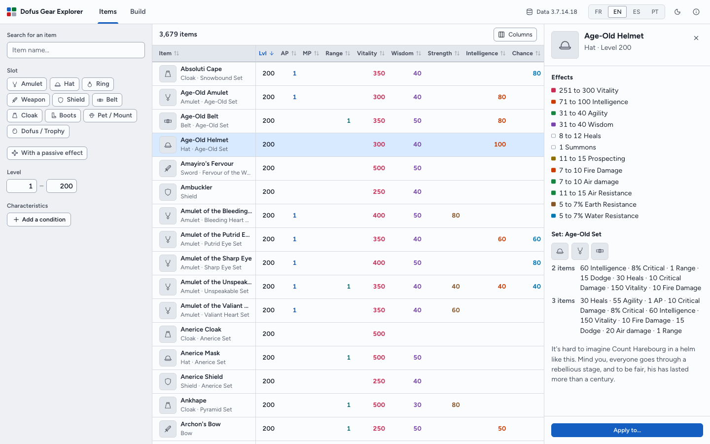
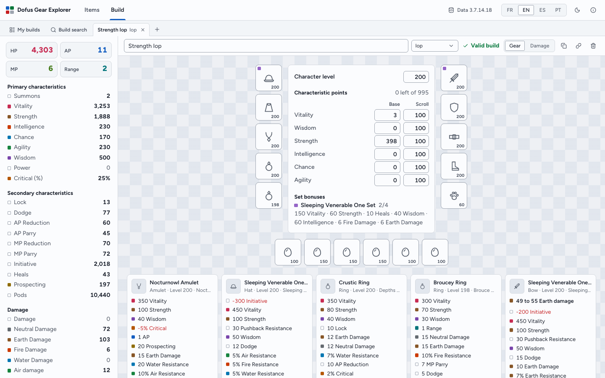
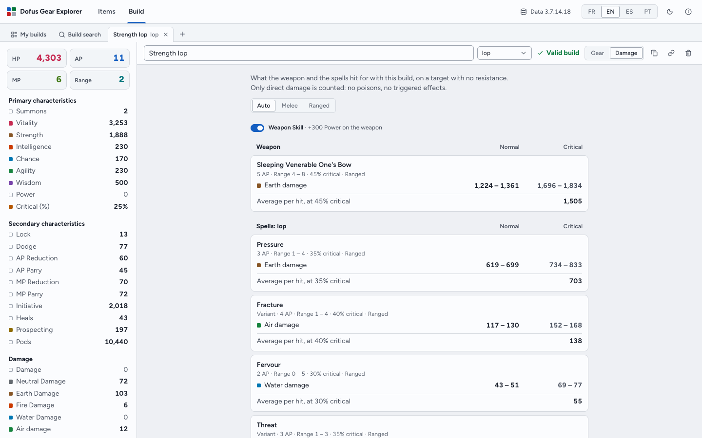
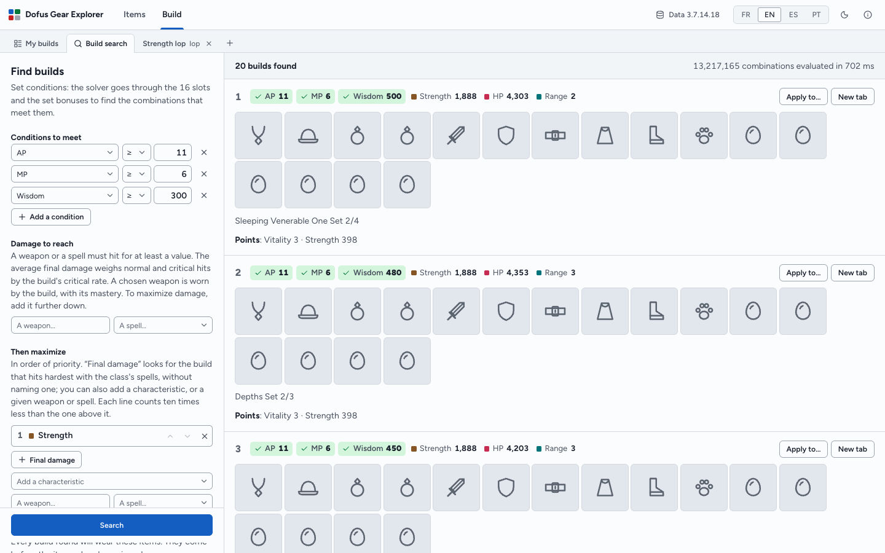

# Dofus Gear Explorer

[](https://github.com/npjonath/dofus-gear-explorer/actions/workflows/ci.yml)
[](../../releases/latest)
[](LICENSE)

**A free and open-source equipment explorer and stuff builder for Dofus, made by players for players.**

Browse every piece of equipment in the game, assemble a stuff with its real characteristics and damage, and let the search find the best stuffs for your conditions, from the game's actual data.

> Dofus Gear Explorer is an unofficial fan project. It is not affiliated with, endorsed or supported by Ankama. See [Not affiliated with Ankama](#not-affiliated-with-ankama).

## Features

- **Items**: all the equipment of the current game version, filtered by slot, level and characteristics, in a sortable table with item cards.
- **Stuffs**: one tab per stuff, a 16-slot builder with characteristics, set bonuses, passive effects and equip conditions. Each item can carry forgemagic: overs, exos, a transcendence rune and a dracorune.
- **Damage**: what the weapon and every spell of the stuff's class hit for, normal and critical, checked against dofusbook on the same stuffs.
- **Stuff search**: set conditions (11 AP, 300 Wisdom, a spell that hits for 1,000…), order what to maximize, require or forbid items, and get the best stuffs with their forgemagic.
- **Sharing**: copy a stuff's code and send it to a friend, who pastes it in "Import". Nothing goes through a server.
- French, English, Spanish and Portuguese, for the interface and the game data. Dark and light theme.

## Screenshots

**Items**: every piece of equipment, filtered and sorted, with its card.

<picture>
  <source media="(prefers-color-scheme: dark)" srcset="docs/screenshots/items-dark.png">
  
</picture>

**Stuff builder**: the 16 slots, characteristic points, set bonuses and the stuff's characteristics.

<picture>
  <source media="(prefers-color-scheme: dark)" srcset="docs/screenshots/build-dark.png">
  
</picture>

**Damage**: what the weapon and each spell of the class hit for.

<picture>
  <source media="(prefers-color-scheme: dark)" srcset="docs/screenshots/damage-dark.png">
  
</picture>

**Stuff search**: conditions to meet, what to maximize, and the best stuffs found.

<picture>
  <source media="(prefers-color-scheme: dark)" srcset="docs/screenshots/search-dark.png">
  
</picture>

The screenshots leave out the item artwork, which belongs to Ankama; in the app, every item shows its icon.

## Your data stays yours

- **The app never asks for your Dofus or Ankama account, your password, or any personal information.** It has no account, no analytics, no tracking and no ads.
- **Everything is stored locally**: your stuffs, your settings and the game data live on your computer.
- **The network is used for two things only**: downloading the game data (from GitHub, published by [doduda](https://github.com/dofusdude/doduda)) and updating the app itself (from this repository's releases).

Details in [PRIVACY.md](PRIVACY.md).

## Download

Get the latest version from the [Releases page](../../releases/latest).

| System | File |
| --- | --- |
| macOS, Apple silicon (M1 and later) | `Dofus-Gear-Explorer-…-mac-arm64.dmg` |
| macOS, Intel | `Dofus-Gear-Explorer-…-mac-x64.dmg` |
| Windows 10 and 11 | `Dofus-Gear-Explorer-…-win-x64-setup.exe` |
| Linux | `Dofus-Gear-Explorer-…-linux-x86_64.AppImage` |

The installers are not signed with a paid certificate, so your system warns you the first time:

- **macOS**: open the `.dmg` and drag the app into Applications. If macOS refuses to open it, go to System Settings, Privacy & Security, and press "Open Anyway". If it says the app is damaged, run this in Terminal:

  ```bash
  xattr -cr "/Applications/Dofus Gear Explorer.app"
  ```

- **Windows**: if SmartScreen stops the installer, press "More info", then "Run anyway".
- **Linux**: make the AppImage executable (`chmod +x`) and run it.

On first launch the app downloads the game data (a few minutes). New versions download and install themselves on every system (on macOS, keep the app in your Applications folder).

## A community project

Dofus Gear Explorer is open source under the MIT licence: anyone can read the code, check how a number is computed, fix it, or build on it.

- **Found a wrong number?** Open an [issue](../../issues/new/choose) with the stuff's code (the share button of the stuff) and the value the game shows. Damage formulas follow dofusbook, which the project uses as its reference.
- **Have an idea or a question?** Start a [discussion](../../discussions), or open an issue and describe what you are trying to do in the game.
- **Want to code?** Read [CONTRIBUTING.md](CONTRIBUTING.md), then [docs/DEVELOPMENT.md](docs/DEVELOPMENT.md) for the architecture, the HTTP API, the forgemagic rules and the solver.

Everyone taking part follows the [code of conduct](CODE_OF_CONDUCT.md). Security issues go through [SECURITY.md](SECURITY.md), not public issues.

## Thanks to doduda

This project would not exist without [doduda](https://github.com/dofusdude/doduda) and the [dofusdude](https://github.com/dofusdude) project, which extract the Dofus game data and publish it as open JSON releases ([dofusdude/dofus3-main](https://github.com/dofusdude/dofus3-main)) after every game update. Dofus Gear Explorer downloads those releases; every item, set, spell and icon you see comes from their work. Thank you!

## Not affiliated with Ankama

Dofus Gear Explorer is an unofficial tool made by fans. It is not affiliated with, endorsed, sponsored or supported by Ankama.

- Dofus is a trademark of Ankama. The Dofus game data, item names, descriptions and artwork are the property of Ankama.
- None of that content is stored in this repository or shipped in the installers. The app downloads it at run time from the doduda releases, displays it for the player's own use, and does not modify or resell it.
- The project is free and non-commercial: no sales, no ads, no paid features.
- The MIT licence covers the project's code only, never Ankama's content.
- If you represent Ankama and want something changed or removed, please [open an issue](../../issues/new/choose); it will be handled promptly.

## Licence

The code is released under the [MIT licence](LICENSE). The licences of the libraries shipped in the app are listed in [THIRD_PARTY_NOTICES.md](THIRD_PARTY_NOTICES.md).
